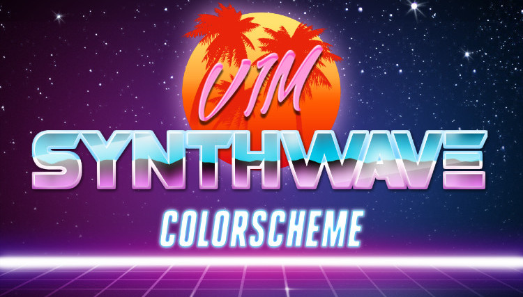
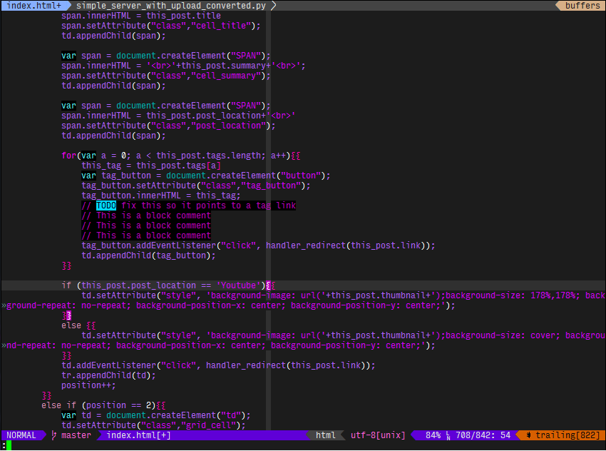
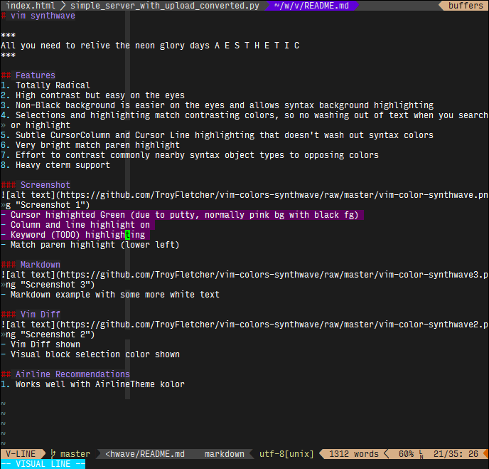
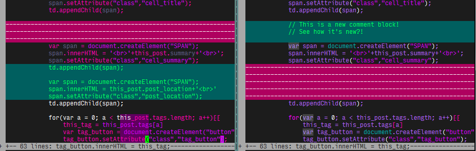

### vim synthwave

***
All you need to relive the neon glory days A E S T H E T I C
***

## Features
1. Totally Radical
2. High contrast but easy on the eyes
3. Non-Black background is easier on the eyes and allows syntax background highlighting
4. Selections and highlighting match contrasting colors, so no washing out of text when you search or highlight
5. Subtle CursorColumn and Cursor Line highlighting that doesn't wash out syntax colors
6. Very bright match paren highlight
7. Effort to contrast commonly nearby syntax object types to opposing colors
8. Heavy cterm support
9. Easily distinguished comments

### Screenshot

- Cursor highighted Green (due to putty, normally pink bg with black fg)
- Column and line highlight on
- Comment block with darker background
- Keyword (TODO) highlighting
- Match paren highlight (lower left)

### Markdown

- Markdown example with some more white text

### Vim Diff

- Vim Diff shown
- Visual block selection color shown

## Airline Recommendations
1. Works well with AirlineTheme kolor

##  📜 License  

This project is **free to use** under **The Coffee License**:  

☕ **Short & Sweet Version:**
- **Individuals & non-commercial use:** Enjoy! No strings attached.
- **Businesses/Orgs:** If this software saves you time/money,
  please [buy me a coffee](https://buymeacoffee.com/troyfletcher).
- **Tweak it lightly** ("Cream & Sugar"), but don’t redistribute your own version.
- **No warranty**, but I’ll help if I can!

Full license: [`LICENSE`](/LICENSE)  

## Support the Project  
If this code helped you, consider [buying me a coffee](https://buymeacoffee.com/troyfletcher) ☕—it keeps me awake while fixing bugs!
